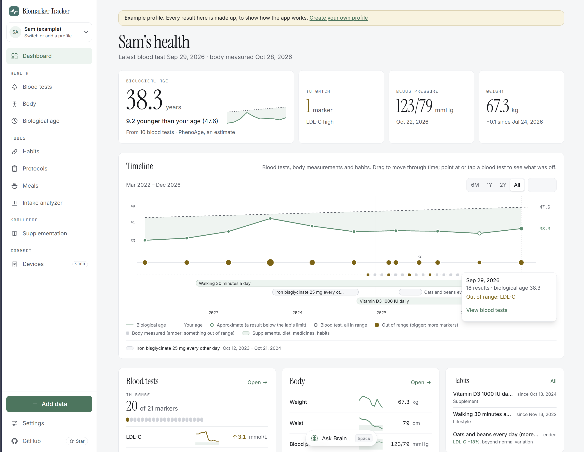
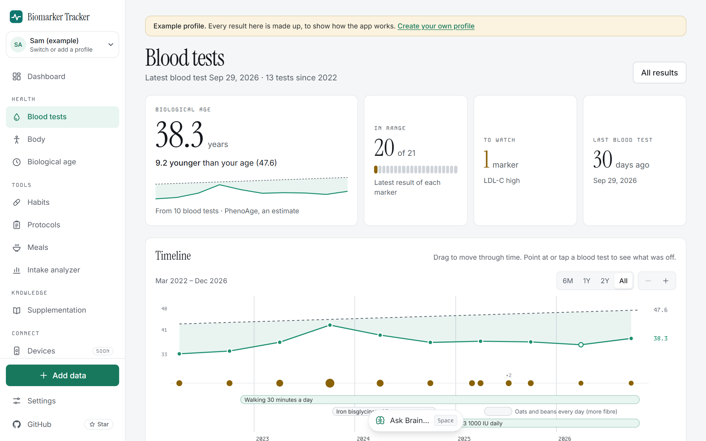
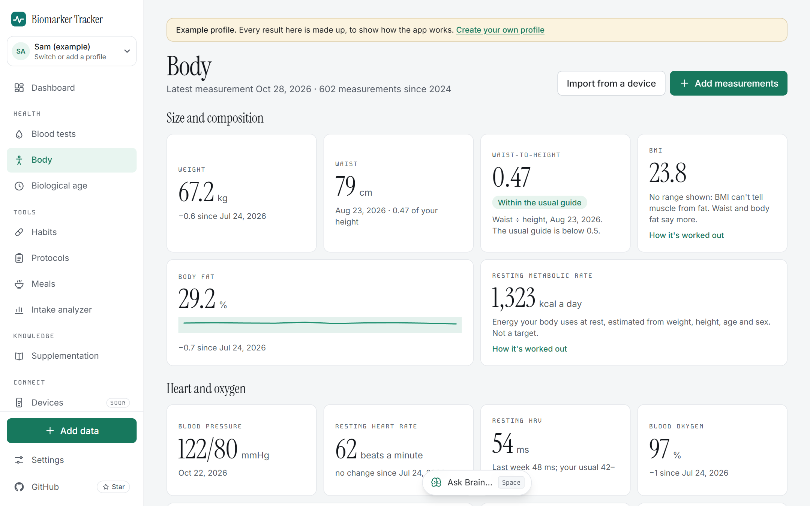
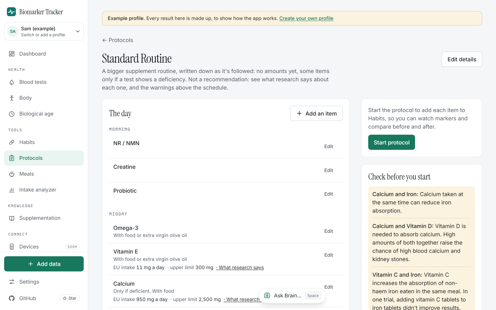
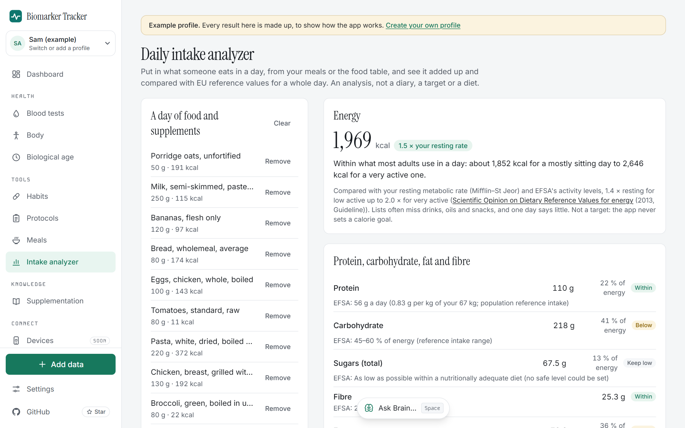
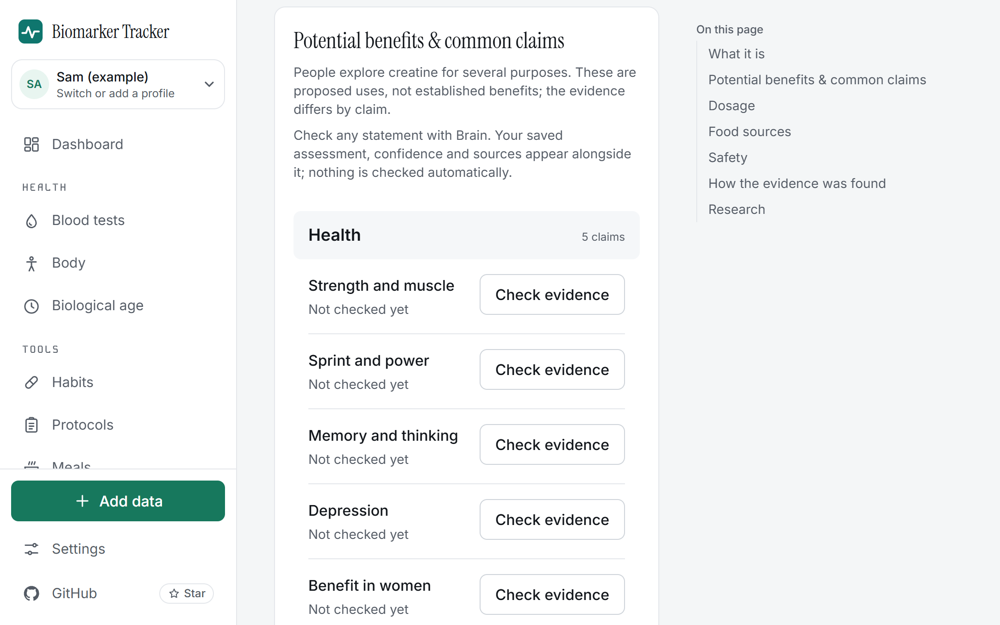
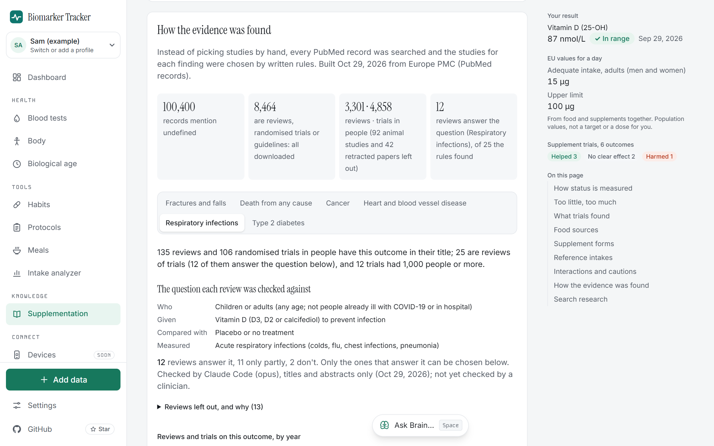

<div align="center">


# Biomarker Tracker

**A private, local-first bloodwork and biomarker tracker.**
Track your lab results and body measurements for years, see your biological age, understand every marker in plain language, and read what the research says. Your health data stays on your computer.




<sub>Screenshots use the built-in example profile. Every result in them is made up.</sub>

</div>

> **Not medical advice. Not a medical device.** The app explains what your results mean and what the evidence says. It never diagnoses, and it never tells you to start or stop a medicine or how much to take.

## Why

Lab portals show one test at a time, and every lab prints the same marker differently. Health apps want an account and upload everything. Biomarker Tracker puts years of your own results side by side, explains them in plain language with sources, and keeps all of it in a folder on your computer.

- **No account, no cloud.** Each person is a folder on your computer. Back it up as a .zip and move it anywhere.
- **No telemetry.** No analytics, no tracking, no error reporting. The page can only talk to itself and two research databases (Europe PMC and PubMed).
- **Works without AI.** Tracking, charts, biological age and the knowledge base work with no model set up. The assistant is optional.
- **Code does the maths.** Unit conversions, trends, ranges and scores come from tested TypeScript, never from a language model.
- **Every claim has a source,** checked against Europe PMC, EFSA or the original paper.

## Features

### Blood tests over the years

Add results by hand, from a lab report PDF, or from a photo of one. Text recognition runs on your device (English, German and Hungarian), and you check every value on a review screen before anything is saved. Markers are recognised in English, German, Hungarian, French, Spanish and Italian, and converted to one unit, so results from different labs line up on one chart.


- 37 blood markers: full blood count, lipids, glucose and HbA1c, liver, kidney, thyroid, iron, vitamin D, B12, folate, CRP and electrolytes. Each has a plain-language explanation, what is known to raise or lower it, and cited sources.
- Charts you can explore: zoom, drag across a period to see its average and change, and overlay the habits you were following at the time.
- Out-of-range flags against your lab's own range. Values far outside it (a lost decimal point) are flagged, and critical values show "contact a doctor" first.
- A research panel on every marker page that searches Europe PMC and PubMed.



### Biological age, heart age and fitness age


- **PhenoAge** (Levine et al., 2018) from nine blood markers taken on the same day, verified against the paper and the BioAge R package.
- **Heart age** from the Framingham general cardiovascular risk model (D'Agostino 2008), with the 10-year risk it is based on.
- **Fitness age** from VO₂max, using healthy-adult averages from the HUNT 3 Fitness Study.
- **Seven age-related fitness tests** (grip strength, push-ups, chair rises, one-leg stand, walking speed, sitting-rising) placed on published norm tables for your age and sex.
- The three ages are never averaged into one number, because they estimate different things.
- Missing your birth month? Enter the month and year and press **Save** directly on the Body or Biological age page. The estimates update together; no day of birth is needed.

### Body measurements and device import



Weight, waist, body fat, blood pressure, resting heart rate, heart rate variability (HRV), blood oxygen, sleep, home blood glucose and VO₂max. Import exports from Apple Health, Fitbit, Google Fit, Samsung Health, Garmin, Oura, Whoop, Withings, Polar, Zepp and Huawei Health, or any CSV or JSON file. Files are read on your computer and never uploaded. No made-up "readiness" or "sleep scores": only what was measured.

Height is in **About** under Settings → Your data, and in the first details step when creating a profile. Choose centimetres or feet and inches. The preference is kept with the profile and in backups; switching units does not change the height used by calculations, which is always stored in centimetres.

Samsung sleep comes from `com.samsung.health.sleep_stage…csv` in the export: light, deep and REM intervals add up to actual time asleep, excluding awake periods. Each session is dated by its final wake-up in the export's recorded time zone, and naps on that date are added. The separate sleep summaries and energy-score inputs are skipped so scores, time in bed and duplicate totals cannot replace actual sleep. Choose the full zip or include the sleep-stage file. Sub-minute intervals are preserved, so a stage total may display a minute differently from Samsung's rounded summary.

Sleep, deep sleep and REM sleep are displayed in hours and minutes throughout the app, including charts, histories, changes, habit comparisons and the import review. Values remain numeric hours in storage and exports; source-unit selectors still describe the numbers in an imported file.

Samsung daily steps use only `source_type = -2` in `com.samsung.shealth.step_daily_trend…csv`: Samsung's combined count with phone/watch overlap removed. Separate device totals and the other Samsung step files are not added. Active time uses `active_time` in `com.samsung.shealth.activity.day_summary…csv`, converted explicitly from milliseconds to minutes; overlapping pedometer durations, exercise parts and detail-bin JSON are skipped. Both use `day_time`, not the date a record was created or updated, and newer daily snapshots replace earlier ones.

Samsung's recorded overnight heart rate and HRV come from `shr_value` (beats/minute) and `shrv_value` (milliseconds) in `com.samsung.shealth.vitality_score…csv`. They populate the resting heart-rate and resting HRV cards; ordinary daytime readings stay separate. Energy Scores, scales, baselines and previous averages are still excluded. These are Samsung's during-sleep summaries, not values calculated from daytime averages.

Samsung walking speed uses `speed` from the same combined daily step records, in metres per second, keeping two decimal places. Per-device copies and workout speeds are not mixed in. [Samsung defines this as the average speed of daily steps](https://developer.samsung.com/health/android/data/api-reference/com/samsung/android/sdk/healthdata/HealthConstants.StepDailyTrend.html#SPEED): it is labelled a **daily average**, not a short timed gait test. It appears in the walking-speed history, but timed-test percentiles, age equivalents and clinical cut-offs are not applied to it.

Body fat is imported as a percentage only. Fat-mass columns in kilograms or pounds (including Samsung Health's `body_fat_mass`) are skipped with an explanation, not relabelled as percentages or converted. Samsung's separate `body_fat` percentage is imported normally.

Re-importing device files updates existing readings for the same measurement and date, including manually entered readings, rather than skipping them. New dates are added and dates absent from the import are kept. The review marks readings that will be updated, and saving reports the update count. Save, Choose other files and Cancel are available above and below the review. If selected series overlap, the first one listed is used for those days. Re-importing a corrected Samsung export can therefore repair previously incorrect values without deleting them first.

### Habits and self-experiments

Log supplements, diet changes, medicines and routines, then watch chosen markers. "What changed" compares before and after against that marker's normal test-to-test variation, using data from the EFLM Biological Variation Database. That way, a real change can be told apart from noise. Results are framed as what happened in you, never as evidence for others.


### Protocols, meals and the intake analyzer



- **Protocols:** a supplement stack, diet or routine as a daily schedule, with interaction warnings between items and with your medicines or conditions. Starting one adds one named habit, with all items kept in collapsible details: amounts, timing, days and notes as they were when started. Later protocol edits or deletion don't change that record. Watch markers for the whole routine; a comparison cannot tell which item caused a change. Older runs recorded as separate habits keep their history.
- **Meals:** build meals from 2,887 foods in the UK CoFID 2021 food table and see what was measured in them, with a note on how much food chemistry those numbers leave out ("nutritional dark matter").
- **Intake analyzer:** compare a day's meals, foods and supplements with EU (EFSA) reference values. No calorie targets and no weight-loss plans.



### Foods, supplements and lifestyle knowledge



Explore whole foods, vitamins, minerals, other supplements and everyday habits. Research entries lead with **main uses and potential benefits**, the people studied and the evidence strength. Normal nutrient roles are kept separate from the effects of taking extra supplements; food findings remain separate from supplement findings.

Personal interaction warnings come first, and safety findings stay visible. Mixed findings and outcomes without a clear benefit are grouped separately under **Other uses studied**. Expand **Research details & sources** for the full findings, grade explanations and citations; a link to a finding opens its research section automatically. Research entries for nutrients also include food sources, EFSA reference intakes and upper limits, and interactions.

**Basic supplement guides** cover the 15 previously missing supplements in Standard Routine, bringing the library to 35 guides. They explain the ingredient, common uses, forms and cautions, with basic references rather than efficacy verdicts. Except for the astaxanthin pilot below, they are labelled **Benefits not yet reviewed**; common uses are purposes, not proven benefits. Protocol items link to these guides without changing the person's routine.

Basic guides set `researchStatus: "not-reviewed"` and `commonUses`, and contain no graded findings or linked evidence claims. Their sources can be general publications or HTTPS public guidance in `basicSources` (such as NIH NCCIH safety pages). Empty findings mean the benefit review has not been done, not that studies found no benefit. These guides do not display unreviewed reference values or deficiency sections.

Additional requested topics are listed by name only: 29 supplements, 32 foods and 8 lifestyle topics. These searchable catalogue names have no descriptions, claims, doses or schedules and do not open empty detail pages. Existing guides are not duplicated or replaced.

**Astaxanthin pilot:** a layered guide in this order: what it is, origin and roles; **Potential benefits & common claims**; **Too little / Too much**; **Dosage & safety** with reference intakes and upper-limit context; an existing evidence map if available; then **Research → Search studies**. Its five claims come from the supplied research notes, not baked-in efficacy findings. `simpleGuide` keeps separately dated stable facts, the claim source and outcome search words. No Astaxanthin map existed in the repository/history, so none is created or shown.

**Check evidence** runs the person's configured Brain model, skills and research sources through `POST /api/claim-evidence`, sending only the public supplement/claim/topic. After live retrieval the model submits its verdict, evidence grade (or no grade when evidence is insufficient), summary, limitations and citations through `submit_claim_assessment`. That structured submission is validated before saving; final chat prose or Markdown is not parsed as JSON. The app stamps the date and serving model; unresolved agent model aliases are labelled as configured. Missing submissions, failed retrieval, invalid fields and unreturned citations cannot become saved grades. Results and custom **Check something else** topics live in the profile's local `claimEvidence` setting, included in folder sync/backups; cached results remain readable without a model, and failed/cancelled rechecks preserve the previous result. Legacy JSON backups keep their existing narrower contract.
 
For saved checks, the page makes a cheap PubMed metadata check at most once daily, without AI. It counts candidate review/trial records indexed after the assessment's UTC day; same-day additions, late tags and unmatched terms can be missed. A positive signal offers **Recheck**, never changes a verdict automatically. The developer-only `bun tools/claims/watch.ts` scans the last complete month for Astaxanthin claims and candidate new MeSH outcomes (at least three distinct trial records), with an annual stable-facts review reminder. `.github/workflows/claim-watch.yml` opens a deduplicated issue only for signals/reminders; it never rewrites claims, grades or evidence maps.

Research-only Brain conversations remain separate from personal chat. `POST /api/assistant` with `scope: "research"` accepts only the latest public question, excluding profiles, history, attachments and photos. **Back to my chat** restores the personal conversation, draft and files. Retrieved citations use the existing verifier; agents without research-tool access are marked unverified. Disconnecting cancels model work, and Hermes's stable bridge token cannot be retargeted to an overlapping request.

**Evidence maps** show how the studies behind each finding were found. Every PubMed record is searched instead of picking papers by hand. Written rules choose the reviews and trials, and a model checks each review against the finding's question, with every decision kept and its reason shown. The map also shows how much the reviews share their trials, and which newer studies aren't on the page yet.



### Brain, the optional assistant

Brain helps with everyday questions about food, supplements, exercise, sleep and work habits, as well as your saved results. Personal chat leads with practical options and their likely benefits and limits; it does not require a fresh literature search or a complete profile for ordinary guidance. Use **Show evidence** for the separate research-focused conversation. Citations are checked against sources the tools returned. Drop a lab report into the chat to add results. Brain never diagnoses or prescribes medicines or supplement doses, and puts critical values first with "contact a doctor".

In personal chat, code detects common profile facts and explicitly stated current measurements in your newest typed message. “I'm 31, 102 kg, 192 cm tall, man, 27% body fat” can fill blank height/sex fields and save weight/body-fat readings together. “im 27% body fat” also works. Named measurements use the app's marker names and aliases, with the existing unit validation and conversions. A stated “pace of aging” is recorded as a reported DunedinPACE result, not the app's calculated PhenoAge pace. This does not depend on the model calling a save tool. After a successful answer, a receipt shows what was actually saved and links to the results. Current readings use today's date; existing same-day readings are never overwritten or duplicated, and a later day can add a new reading. Existing profile details stay unchanged. Other people's details, quoted examples, attachments, targets and past-tense readings are not silently saved; “don't save this” prevents capture. A stated age does not become a guessed birth date.

Ask Brain to create a **protocol, meal or habit**, or ask for recommendations, and it can show a review card instead of only describing one. Nothing is created or started until you confirm. Recorded routines keep your own amounts; suggested protocols can include example activity durations or frequencies, but never medicines or supplement doses. Suggested meals use real food-table entries, example portions and the app's calculated totals. Safety checks still apply, and critical results block all three kinds of draft. Creation cards need a model or connected agent with access to the app's tools; research-only conversations cannot change personal data.

You choose the model:

- **Cloud providers with zero data retention:** Anthropic, OpenAI, Mistral, or your own endpoint, in the EU or US. OpenRouter is also supported, with zero-retention routing forced on every request.
- **Local models** through Ollama or LM Studio.
- **Agent programs you've signed into:** Claude Code, Codex, Hermes or OpenClaw. These are labelled "depends on your login", because the app can't check what they keep.

Your name and private notes are never sent. Optional Skills and medical MCP servers (PubMed, ClinicalTrials.gov, openFDA, medical terminologies, food data) add research tools.

### Works on your phone


## Desktop app

Download the installer for your computer from [Releases](https://github.com/ai-2070/biomarker-tracker/releases): Windows `.exe` or `.msi`, macOS `.dmg` (Apple Silicon or Intel), or Linux `.AppImage` / `.deb` (x64). The Tauri v2 app includes its own local server and runtime; Bun and Node are not required for tracking, imports, backups or API-based AI providers. Optional agent programs and MCP servers still need their own installed tools.

Profiles, settings and API keys live in the operating system's local application-data folder, under `io.github.ai-2070.biomarker-tracker` (Windows: `%LOCALAPPDATA%`; macOS: `~/Library/Application Support`; Linux: `${XDG_DATA_HOME:-~/.local/share}`). Set `BT_DATA` to choose another folder. The desktop app uses a separate data folder from `bun run start`. Move existing profiles with the app's backup/import controls. Upgrading the app preserves this folder.

The bundled server listens only on `127.0.0.1:4821` and closes with the app. Opening the app again focuses its existing window. If another program occupies that port, startup reports an error. External research links open in your browser.

### Develop and package the desktop app

Install Bun 1.4.4, Rust stable and the [Tauri platform prerequisites](https://v2.tauri.app/start/prerequisites/), then:

```sh
bun install --frozen-lockfile
bun run desktop:dev      # builds the frontend and sidecar, then opens the native window
bun run desktop:build    # builds installers in src-tauri/target/release/bundle/
```

Desktop development rebuilds the static frontend on launch; restart it after changes. For frontend hot reload, use the browser development commands below. `desktop:prepare` compiles the Bun server, copies only `dist/`, `knowledge/` and bundled `skills/` as resources, and smoke-tests native sidecar builds against a temporary data folder. App icons derive from `public/favicon.svg`.

### CI and releases

[Desktop packages](.github/workflows/desktop.yml) runs type checks and tests, then builds Windows x64 (NSIS + MSI), Linux x64 (DEB + AppImage), and macOS Apple Silicon + Intel (DMG). Pull requests and pushes to `main` keep installers as workflow artifacts.

To release, set the same version in `package.json`, `src-tauri/Cargo.toml` and `src-tauri/tauri.conf.json`, update the lockfiles, then push a matching tag such as `v0.11.0`. CI creates a draft GitHub release and attaches the installers; publish it after reviewing the assets. Publishing an existing release also builds and attaches packages. You can rerun packaging through **Run workflow**, optionally supplying an existing release tag. Tags must match the application version; tags with a hyphen produce prereleases.

GitHub's built-in token handles release uploads; no personal access token is needed. Installers are unsigned by default. For signed and notarized macOS builds, configure `APPLE_CERTIFICATE` (base64 `.p12`), `APPLE_CERTIFICATE_PASSWORD`, `APPLE_SIGNING_IDENTITY`, `APPLE_ID`, `APPLE_PASSWORD` (app-specific password), and `APPLE_TEAM_ID` as repository secrets. Unsigned macOS and Windows downloads may require operating-system approval before opening.

## Quick start

Requires [Bun](https://bun.sh). The optional research servers (MCP) also need Node.js.

```bash
git clone https://github.com/ai-2070/biomarker-tracker.git
cd biomarker-tracker
bun install
bun run start      # builds the app and serves it at http://localhost:4820
```

The first start asks who you are, or lets you load a backup. To look around first, choose **Just looking?** for the example profile with two years of made-up data.

Your data is kept in `data/` next to the app: one folder per person, plus your settings. API keys stay in `data/secrets.json`, are never sent to the page, and are never put in backups.

### Develop

```bash
bun run dev        # the app with hot reload at http://localhost:5173
bun run server     # the local server on 127.0.0.1:4820 (run next to dev)
bun run test       # Vitest: core logic, knowledge base, database
bun run build      # typecheck and static build in dist/
```

Use `bun run test`, not `bun test`: the second one starts Bun's own test runner instead of Vitest.

## How it's built

**Stack:** Vite, React 19, TypeScript (strict), Tailwind CSS v4, Base UI, Dexie (IndexedDB), Recharts, pdf.js, tesseract.js, Vitest. The local server is plain `node:http`, run by Bun, listening on 127.0.0.1 only.

```
src/core        pure TypeScript with tests: units, trends, ranges, PhenoAge, heart and fitness age,
                experiments, importers (lab PDFs, photos, device exports), meals, intake, evidence maps
src/app         React UI
src/db          Dexie schema
server          local server: profiles, models, skills, MCP, the assistant and its tools
knowledge       biomarkers, evidence claims, nutrients, fitness tests, foods, evidence maps
skills          built-in assistant skills
tools           developer tools that build the knowledge files (food table, evidence maps)
tests           Vitest suites with synthetic fixtures (no real patient data)
```

The rules every change follows are in [`CLAUDE.md`](CLAUDE.md). Product and design notes are in [`PRODUCT.md`](PRODUCT.md) and [`DESIGN.md`](DESIGN.md).

## Privacy

- The production build ships a Content Security Policy whose `connect-src` allows only the app itself, Europe PMC and PubMed.
- The page never calls an AI model. The local server does, only when you ask a question, and only to the provider you set up.
- Lab reports, photos and device exports are read on your computer. Photos are sent to a model only if you tick "Send the photo itself", and location data is removed first.
- MCP servers you switch on receive search terms, not your results.

## Status and roadmap

In active development, private for now. Next on the roadmap:

- Automatic sync from phones (an Android companion app reading Health Connect over your local network).
- Evidence maps for every supplement in the knowledge base.
- A clinician's review of the evidence grades and wording.

## Disclaimer

Biomarker Tracker is for information and personal record-keeping. It is not medical advice, not a medical device, and not a substitute for a doctor. Reference ranges, evidence grades and estimates such as biological age are general, may not apply to you, and have not yet been reviewed by a clinician. Talk to your doctor about any result that worries you, and before changing medicines or supplements.
