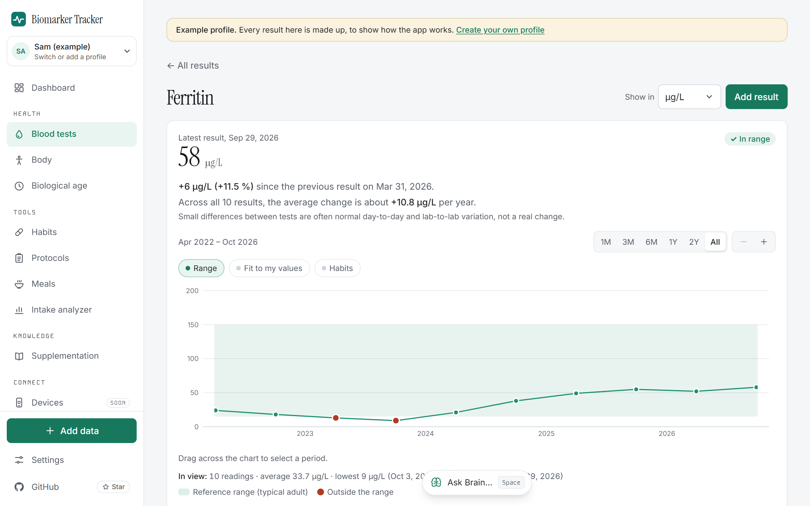
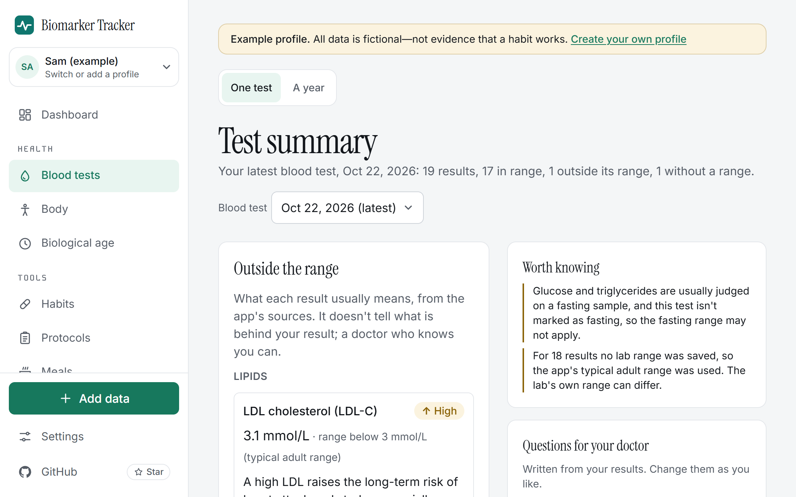
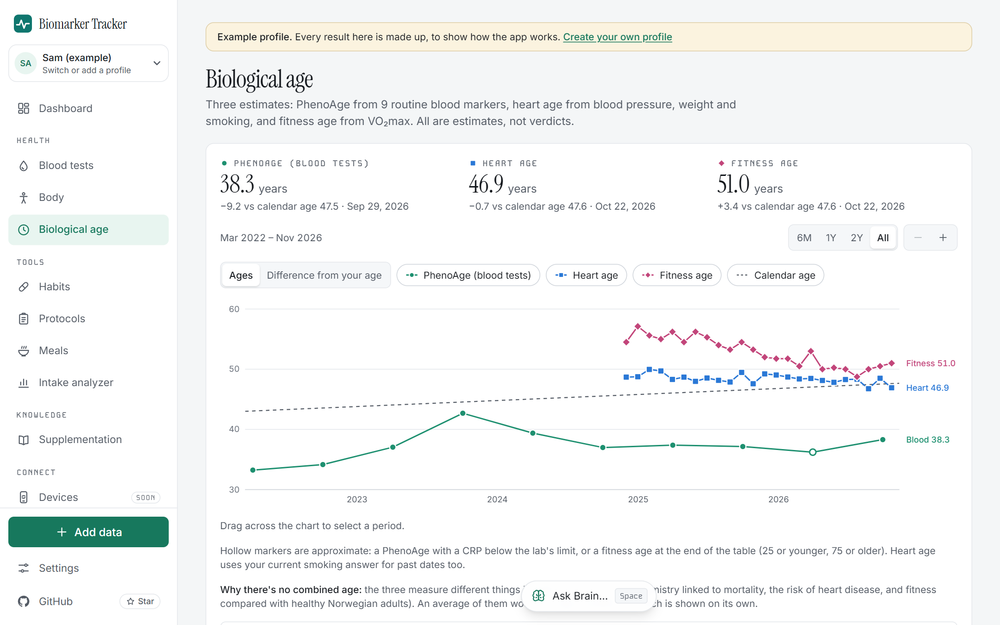
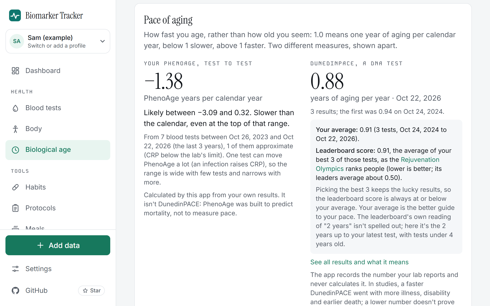
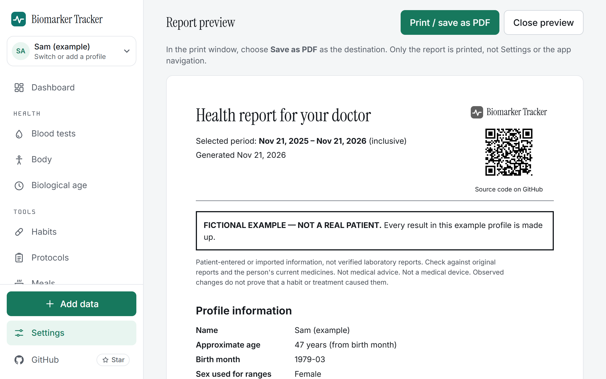
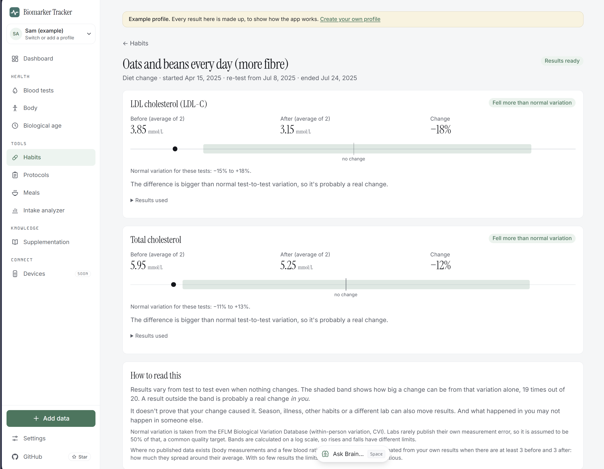
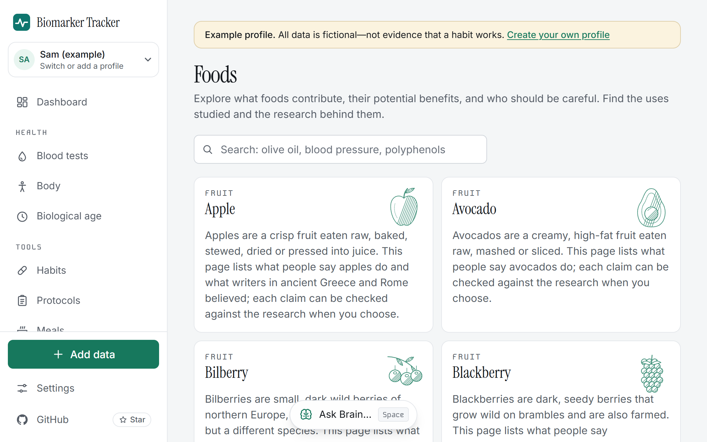
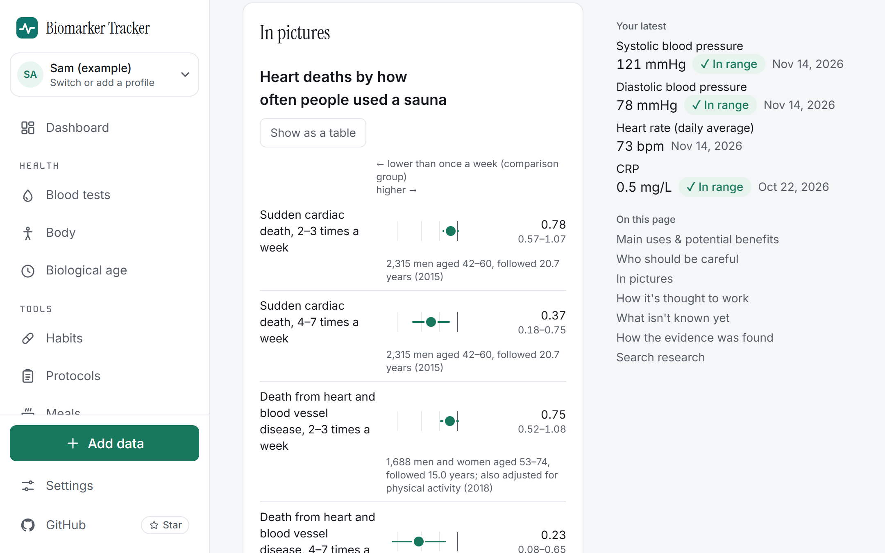
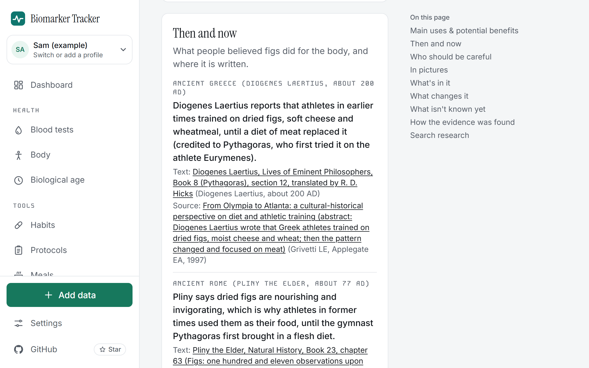
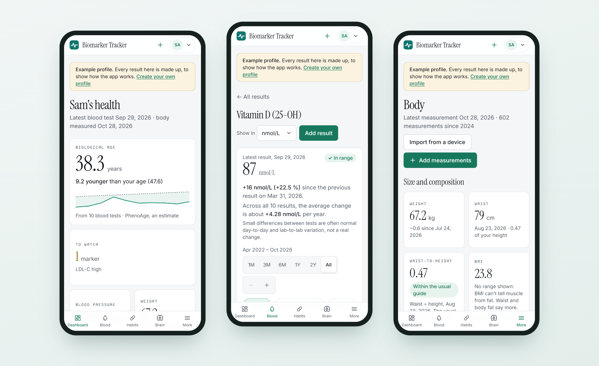

<div align="center">


# Biomarker Tracker

**A private, local-first bloodwork and biomarker tracker.**
Track your lab results and body measurements for years, see your biological age, understand every marker in plain language, and read what the research says. Your health data stays on your computer.


<sub>Screenshots use the built-in example profile. Every result in them is made up.</sub>

</div>

> **Not medical advice. Not a medical device.** The app explains what your results mean and what the evidence says. It never diagnoses, and it never tells you to start or stop a medicine or how much to take.

## Why

Lab portals show one test at a time, and every lab prints the same marker differently. Health apps want an account and upload everything. Biomarker Tracker puts years of your own results side by side, explains them in plain language with sources, and keeps all of it in a folder on your computer.

- **No account, no cloud.** Each person is a folder on your computer. Back it up as a .zip and move it anywhere.
- **No telemetry.** No analytics, no tracking, no error reporting. The page can only talk to itself and two research databases (Europe PMC and PubMed).
- **Works without AI.** Tracking, charts, biological age and the knowledge base work with no model set up. The assistant is optional.
- **Code does the maths.** Unit conversions, trends, ranges and scores come from tested TypeScript, never from a language model.
- **Every claim has a source,** checked against Europe PMC, EFSA or the original paper.

## Features

### Blood tests over the years

Add results by hand, from a lab report PDF, or from a photo of one. PDFs with text are read on your device; photos and scanned PDFs are sent, after you confirm, to the AI model you set up for Brain, which reads the values. Either way you check every value on a review screen before anything is saved. Markers are recognised in English, German, Hungarian, French, Spanish and Italian, and converted to one unit, so results from different labs line up on one chart.

The review for PDFs and photos includes the sample date, lab name, **Were you fasting?** (Yes / No / Not sure), and an optional note. Fasting status and the note apply to every selected result saved from that report.



- 81 blood and urine markers: full blood count with differentials, lipids (including ApoA-I, ApoB, Lp(a), ApoB/ApoA-I ratio, LDL/HDL ratio and non-HDL cholesterol), glucose, HbA1c, insulin and C-peptide, liver, kidney, thyroid, iron, vitamin D, B12, folate, calcium, magnesium, zinc, homocysteine, uric acid, CRP, electrolytes, urine albumin and creatinine, and a **Hormones** group (testosterone, free testosterone, SHBG, estradiol, LH, FSH, prolactin, progesterone, cortisol, DHEA-S, IGF-1, PSA). Where normal depends on sex, age, cycle or treatment, a marker has no universal range and your lab's own range decides the flag. Each has a plain-language explanation, what is known to raise or lower it, and cited sources.
- **All results** shows the complete blood catalogue by category, even for an empty profile. Unmeasured markers say **No results yet** and open their explanation page. The five extended lipid markers stay visible without readings. The Blood dashboard keeps a compact set of saved readings instead of listing unmeasured markers.
- **Find a marker:** search by name, abbreviation or lab spelling, and filter by category such as Lipids, Kidney or **Aging (DunedinPACE)**. Combine these with All / Out of range / In range / **No results**; counts reflect the current search and category. Saved readings without a range assessment remain under All, not No results or In range. Clear filters resets the whole view.
- Charts you can explore: zoom, drag across a period to see its average and change, and overlay the habits you were following at the time.
- Out-of-range flags against your lab's own range. Values far outside it (a lost decimal point) are flagged, and critical values show "contact a doctor" first.
- A research panel on every marker page that searches Europe PMC and PubMed.
- **Edit and bulk delete:** choose **Manage results** on Blood tests or Body, or edit directly in a marker's result history. Search by marker, lab or note and filter by date. Every saved-result list shows **10 readings per page**, with Previous/Next controls. Select individual readings or all matching results across every page; deletion requires confirmation and keeps original report files. Selection survives paging, while changing a filter resets it and returns to the first page. Edits preserve result IDs and import sources, and charts and profile folders update with the changes.

The five extended lipid markers work with manual entry, PDF/photo review, charts and doctor reports. ApoA-I and ApoB support g/L, mg/dL and mg/L; non-HDL supports mmol/L and mg/dL. The two ratios are dimensionless and can be read from reports without a printed unit. These entries use your lab's supplied range rather than a universal app threshold. Ratios and non-HDL are recorded as reported, not silently calculated from other results.


### Test and year summaries



Open **Summary of the latest test** on Blood tests, or **Summary of this test** on the timeline, for one blood test explained in plain words: critical results first, results outside the range by category with what high and low can mean, change since the previous result judged against normal test-to-test variation, results back in range, and things worth knowing (fasting, supplements that skew a lab test, values read from a photo). **Questions for your doctor** are written from your own numbers and can be copied or added to the doctor report. The **A year** tab compares the last 12 months (or a calendar year) with the period before, test to test, and shows a trend only with three or more results over at least a year. It explains; it never diagnoses or says what to take.

### Biological age, heart age and fitness age



- **PhenoAge** (Levine et al., 2018) from nine blood markers taken on the same day, verified against the paper and the BioAge R package.
- **Heart age** from the Framingham general cardiovascular risk model (D'Agostino 2008), with the 10-year risk it is based on.
- **Fitness age** from VO₂max, using healthy-adult averages from the HUNT 3 Fitness Study.
- **Seven age-related fitness tests** (grip strength, push-ups, chair rises, one-leg stand, walking speed, sitting-rising) placed on published norm tables for your age and sex.
- The three ages are never averaged into one number, because they estimate different things.
- Missing your birth month? Enter the month and year and press **Save** directly on the Body or Biological age page. The estimates update together; no day of birth is needed.

**Pace of aging** shows two measures side by side, never averaged. **Your PhenoAge, test to test** is the slope of your PhenoAge over the blood tests of the last three years (at least three tests over a year or more), with a 95 % range; it says slower or faster only when the whole range agrees, and it is labelled as calculated by the app, not DunedinPACE. **DunedinPACE** is a DNA methylation test from a specialised lab: the app records the number your lab reports and never calculates it, and shows your average and the Rejuvenation Olympics leaderboard score (the average of your best 3 tests over 2 years), with a note that the best 3 always sit at or below your average.



**What has moved these clocks in studies** lists the 12 things tested in people against PhenoAge, DunedinPACE and other methylation clocks (calorie restriction, omega-3, multivitamins, exercise, diets, metformin and more), each graded, including the ones where nothing changed. A note says these clocks are stand-ins: nobody has shown that lowering them adds years. Linked food, supplement and lifestyle pages show the same result as an **Aging clocks** note.

**Watch your PhenoAge in Habits:** once you have a complete PhenoAge test, a habit can watch the **PhenoAge gap** (PhenoAge minus calendar age at each test). It is compared like any marker, with the noise taken from your own tests, and the page says lowering the gap hasn't been shown to add years.

**Country population reference (always available):** the Biological age page shows a survival curve, median age reached, average remaining years and the middle-half age range for people alive at your current age. The curve marks **Your age** and has a table view. It uses the country in Settings; if missing, choose it on the page and press **Save**. Your health readings do not change this reference. It assumes the source period's death rates stay constant, not that they predict your future.

**Country population reference** sits immediately above **Heart age**. Within it, **Population survival from your current age** comes first, followed by **Compare countries**, ranking all available tables by average remaining life at the same age and sex, with your saved country highlighted. The zero-based bars cover 37 countries plus the EU average; scroll to see the full list. Each row shows its reporting period, with source links and population limits available below. Missing combined-sex tables are named rather than replaced with invented averages. Different periods and source populations mean this is not a same-year healthcare ranking or a prediction of what moving country would do. When enabled, **Expiration date** is mounted separately at the top of the page, above the Ages chart.

Official tables cover 31 EU/EFTA countries and the EU average (Eurostat), plus the **United States, United Kingdom, Canada, Australia, New Zealand and Japan** from their national statistical or health offices. Every country displays its own source, reporting period and limitations. Where the publisher supplies only female/male tables, the app asks for sex rather than inventing an average. Japan's source covers Japanese nationals in Japan; provisional-data notes are retained.

**Expiration date (optional, experimental):** turn it on in **Settings → Appearance** to add exact calendar dates. When compatible readings are available, a separately labelled projection uses jointly fitted mortality risk from body fat, waist-to-height, smoking and/or clinical PhenoAge. The country statistics and chart remain available even when dates are off. Body-fat variants cover ages 20–69; blood-only variants cover 20–84. This works without AI.

These coefficients come from public NHANES examinations and linked mortality, not weights added up from unrelated papers. The ten-year score was tested on a later, untouched survey wave, but overpredicted average mortality; the card shows predicted versus observed rates. **A lifetime date, individual risk or benefit from changing one input has not been clinically validated.** Its date range is a population spread, not a personal confidence interval.

Active time is used only after you confirm that the saved minutes are actual moderate-or-harder leisure exercise in sessions of at least ten minutes, with vigorous minutes counted once—not generic all-day activity, zone points or doubled intensity minutes. It requires at least 21 daily totals in the last 30 days; missing days are not zero. Resting HRV, DunedinPACE and functional tests remain visible as **not included**, because compatible joint training data was not available. No weights are guessed for them.

### Body measurements and device import


Weight, waist, body fat, blood pressure, resting heart rate, heart rate variability (HRV), blood oxygen, sleep, home blood glucose and VO₂max. Import exports from Apple Health, Fitbit, Google Fit, Samsung Health, Garmin, Oura, Whoop, Withings, Polar, Zepp and Huawei Health, or any CSV or JSON file. Files are read on your computer and never uploaded. No made-up "readiness" or "sleep scores": only what was measured.

- **Heart rate variability** has no population range, so the app shows **your usual range**: the spread of your own readings in the 60 days before the last week, with last week's average marked inside, below or above it. It is never a medical flag.
- **Activity:** daily steps lead with last week's daily average, with no official target. Active minutes (moderate or harder) are checked as a **weekly total** against the WHO's 150 minutes; single days are never flagged.
- **Sleep** is judged on the week's average against the 7 to 9 hour range, not on single nights. Deep and REM sleep have no range, because wearables misjudge sleep stages.
- **Waist-to-height:** the Waist page draws your ratio at every measurement on Ashwell's ranges, and shows the years of life lost from Ashwell et al. 2014 copied exactly from the paper, with your row and ratio marked and nothing filled in between.
- **Resting metabolic rate** (Mifflin–St Jeor) opens a window with the sum worked through with your own numbers, and adds Cunningham's lean-mass equation beside it when you have a body-fat reading. It is an estimate of about ±10 %, never a calorie target.

**Body-fat comparisons:** the Body fat page keeps its existing history chart and adds a separate comparison with your reading marked. The main reference uses sex and age at the reading (20–79 years), with neutral Below reference / Within reference / Above reference / Above reference (upper band) labels. These provisional, BMI-derived values are not minimum and maximum healthy body-fat levels. A position outside them alone does not produce a clinical Low/High/Normal badge, a “To watch” warning or a doctor alert; explicit laboratory ranges and critical limits still apply. Brain and doctor reports receive the same comparison-only distinction. An expandable five-category reference—essential fat, athletes, fitness, average and obesity—is sex-specific but not age-adjusted, and does not assess athletic fitness. Missing details or unsupported ages never produce invented age bands. Weight and BMI do not gain classification bands.

**Estimated fat mass:** directly below the latest body-fat percentage, see the calculated amount in kg and lb. It uses an exact weight from the same day where available, otherwise the nearest within 30 days, with the weight's date shown. It respects your weight display-unit preference. Distant weights and bounded percentages are not silently combined, and the estimate is never saved as a new measurement.

Both systolic and diastolic marker links open one **Blood pressure** page. It shows the top and bottom numbers in separate charts, with linked date controls but independent units, reference ranges and flags. Both explanations and the shared editable results list stay on that page. If one number has no readings, the other is still shown; a critical value in either number puts the urgent warning first.

**New-profile setup** requires a name, birth month and year, sex and a valid height before continuing. Age and sex help select appropriate reference ranges and age-related estimates; height is used for body calculations. Incomplete or future birth dates and invalid height drafts cannot reuse an earlier valid entry to get past setup. Existing profiles and restored backups remain usable with missing details.

Height is in **About** under Settings → Your data, and in the first details step when creating a profile. Choose centimetres or feet and inches. The preference is kept with the profile and in backups; switching units does not change the height used by calculations, which is always stored in centimetres.

Samsung sleep comes from `com.samsung.health.sleep_stage…csv` in the export: light, deep and REM intervals add up to actual time asleep, excluding awake periods. Each session is dated by its final wake-up in the export's recorded time zone, and naps on that date are added. The separate sleep summaries and energy-score inputs are skipped so scores, time in bed and duplicate totals cannot replace actual sleep. Choose the full zip or include the sleep-stage file. Sub-minute intervals are preserved, so a stage total may display a minute differently from Samsung's rounded summary.

Sleep, deep sleep and REM sleep are displayed in hours and minutes throughout the app, including charts, histories, changes, habit comparisons and the import review. Values remain numeric hours in storage and exports; source-unit selectors still describe the numbers in an imported file.

**Sleep timing & regularity:** a separate block on the **Sleep marker page**, opened from Body's Sleep figure—not on the Body dashboard—charts recorded start/end windows in the source's local clock. Naps remain separate; the longest window is marked as the main session. Recorded asleep bounds, time-in-bed windows and generic session estimates keep their different meanings—none is presented as the exact moment someone fell asleep. Date-range controls, keyboard interaction and tables accompany the timing and night-to-night shift charts.

Timing is retained from Samsung sleep-stage files, Apple Health XML, explicit Fitbit/WHOOP start/end fields, Oura bedtime windows, Garmin local timestamps and recognized CSV/JSON sleep intervals. Availability depends on the file. UTC-only timestamps require the original source offset to establish local times; this computer's time zone is never substituted. Health Connect-style interval JSON can be read when it supplies the required fields, but Health Connect backup ZIPs and automatic phone synchronization are not supported by this feature. Existing duration-only history needs re-importing from the original files; hours alone cannot reconstruct bedtimes. The import review shows how many nights have timings and whether offsets are known.

Regularity is the **average absolute start/end clock-time change between consecutive waking dates**, from the same known source and window kind. Missing days and source changes are not joined. This descriptive number is not a Sleep Regularity Index, health score or target. Optional **Compare with resting heart rate or HRV** plots explicitly selected sleep timing against resting heart rate or resting RMSSD on the same waking dates; daytime HRV, exercise pulse and SDNN are not substituted, and missing readings are not carried forward. A same-date reading need not cover that exact sleep window. The dots show associations, not causes, predictions or an ideal bedtime; the section links to the [laboratory sleep-stage/circadian study](https://pubmed.ncbi.nlm.nih.gov/24293767/) and [observational bedtime/resting-heart-rate study](https://pubmed.ncbi.nlm.nih.gov/32219180/).

Sleep-window metadata stays with the saved daily sleep reading through profile folders and backups. Re-importing updates or clears it with that reading. Note/unit-only edits retain it; changing the measurement, date, canonical value or qualifier clears stale timing. Brain's body summary returns the app's computed timing/regularity figures and pair counts, with the same limits, rather than asking the model to calculate them.

The fictional example includes ten weeks of recorded sleep windows, with same-date resting pulse and resting HRV for trying the comparisons. Existing recognizable, untouched example-watch readings receive a one-time upgrade without changing their recorded durations or IDs. Real profiles and imported or edited readings are never given invented timing data; a later duration-only re-import is not silently repopulated.

Samsung daily steps use only `source_type = -2` in `com.samsung.shealth.step_daily_trend…csv`: Samsung's combined count with phone/watch overlap removed. Separate device totals and the other Samsung step files are not added. Active time uses `active_time` in `com.samsung.shealth.activity.day_summary…csv`, converted explicitly from milliseconds to minutes; overlapping pedometer durations, exercise parts and detail-bin JSON are skipped. Both use `day_time`, not the date a record was created or updated, and newer daily snapshots replace earlier ones.

Samsung's recorded overnight heart rate and HRV come from `shr_value` (beats/minute) and `shrv_value` (milliseconds) in `com.samsung.shealth.vitality_score…csv`. They populate the resting heart-rate and resting HRV cards; ordinary daytime readings stay separate. Energy Scores, scales, baselines and previous averages are still excluded. These are Samsung's during-sleep summaries, not values calculated from daytime averages.

Samsung walking speed uses `speed` from the same combined daily step records, in metres per second, keeping two decimal places. Per-device copies and workout speeds are not mixed in. [Samsung defines this as the average speed of daily steps](https://developer.samsung.com/health/android/data/api-reference/com/samsung/android/sdk/healthdata/HealthConstants.StepDailyTrend.html#SPEED): it is labelled a **daily average**, not a short timed gait test. It appears in the walking-speed history, but timed-test percentiles, age equivalents and clinical cut-offs are not applied to it.

Body fat is imported as a percentage only. Fat-mass columns in kilograms or pounds (including Samsung Health's `body_fat_mass`) are skipped with an explanation, not relabelled as percentages or converted. Samsung's separate `body_fat` percentage is imported normally.

Re-importing device files updates existing readings for the same measurement and date, including manually entered readings, rather than skipping them. New dates are added and dates absent from the import are kept. The review marks readings that will be updated, and saving reports the update count. Save, Choose other files and Cancel are available above and below the review. If selected series overlap, the first one listed is used for those days. Re-importing a corrected Samsung export can therefore repair previously incorrect values without deleting them first.

### A report for your doctor



In **Settings → Your data → Doctor-ready report**, choose the dates and measurements to share, create a preview, then press **Print / save as PDF** and select your browser's **Save as PDF** destination. Only the report is printed, not Settings or the app navigation. It works locally without AI, a server or an external PDF service. You can also ask **Brain** where to export a report for your doctor; it explains these steps rather than claiming to create or send the PDF itself.

The summary shows only the latest result, date, reference range and flag for each selected measurement, separated into **Blood tests** and **Body measurements**. Body measurements use the same groups and order as the Body page, including adjacent systolic and diastolic blood pressure readings. Reading details contain black-and-white charts of **every selected reading within the dates**, including daily device history, without a value-by-value list. Reported limits use arrows rather than exact-value dots; readings are never averaged or removed.

Optional profile information includes the latest recorded weight on or before the report end, with its date and unit, even if weight is not selected for a chart. With profile details included, **BMI and the Mifflin–St Jeor resting metabolic rate estimate appear both in Profile information and under Body measurements → Size and composition**. The top shows the values; Size and composition adds the equation, inputs and limits. They are calculated figures, not additional saved readings; the equation uses age at the weight reading and is not a calorie target. These fields are omitted when profile details are off.

**Include questions to discuss** adds the questions from the test summary of the latest blood test in the period. Source and fasting context remain beside each chart. Logged medicines, supplements and habits are optional; grouped protocols retain their recorded item lists. Weekly activity references are not presented as daily ranges. Private profile/result/protocol-item notes are excluded unless selected. Example data stays clearly labelled on every printed page, and changes are not presented as evidence that a habit caused them. The report header includes the app logo, name and an embedded GitHub QR code containing only the public repository URL. This handout is not a backup or a verified laboratory report.

### Habits and self-experiments

Log supplements, diet changes, medicines and routines, then watch chosen markers. "What changed" compares before and after against that marker's normal test-to-test variation, estimated from your own results (at least 3 before and 3 after). That way, a real change can be told apart from noise. Results are framed as what happened in you, never as evidence for others.



### Protocols, meals and the intake analyzer


- **Protocols:** a supplement stack, diet or routine as a daily schedule, with interaction warnings between items and with your medicines or conditions. Starting one adds one named habit, with all items kept in collapsible details: amounts, timing, days and notes as they were when started. Later protocol edits or deletion don't change that record. Watch markers for the whole routine; a comparison cannot tell which item caused a change. Older runs recorded as separate habits keep their history.
- **Meals:** build meals from 2,887 foods in the UK CoFID 2021 food table and see what was measured in them, with a note on how much food chemistry those numbers leave out ("nutritional dark matter"). **Example meals "for your results"** appear when a marker is out of range in a direction a food study addresses, and are hidden when they clash with your medicines or conditions (spinach with blood thinners, for example).
- **Whole foods compared:** 30 claims people make about animal and plant foods (the food matrix, absorption, vitamins, safety: fibre, phytate, oxalate, heavy metals, amino acids), each with a verdict, a grade, what the other side says and an evidence map. No diet is recommended.
- **Intake analyzer:** compare a day's meals, foods and supplements with EU (EFSA) reference values. No calorie targets and no weight-loss plans. **Load a protocol** adds a protocol's meals, foods and supplements in one go (amounts it can't read are listed for you to type in from the label, never guessed), and **Create a protocol from this** turns the list back into one. **What would add the most** names foods and your own meals with the most of the nutrients furthest below the reference, leaving out foods your medicines, conditions or upper limits rule out; supplements are only a link to their page, never an amount.
- **Start as a habit** and **Add to a protocol** are on every food, supplement, lifestyle and meal page (sleep links to your sleep chart instead), so what you read about can become something you track.


### Foods, supplements and lifestyle knowledge



The Knowledge pages cover **60 whole foods, 64 supplements** (vitamins, minerals and others such as creatine, omega-3, CoQ10, melatonin and curcumin) and **14 lifestyle topics**. Search finds an entry by any of its names. Foods, supplements and habits are kept apart: a food holds thousands of compounds, and a study of people eating it is a different thing from a study of one nutrient in a pill.

Every page has **Common claims to check**: what people say it does, grouped under Health, Longevity and Appearance, from well-supported to myth. A claim says **Not checked yet** until you press **Check evidence** (see below); the app ships no verdicts of its own for these. Personal warnings come first when your medicines or conditions interact with the entry.


- **Supplements** use one guide layout: what it is and where it comes from, potential benefits and common claims, dosage as official bodies describe it (EFSA reference intakes and upper limits, never a personal dose), food sources with amounts computed from the food table, safety and interactions, and research. Twenty of them (vitamins, minerals, creatine, omega-3, CoQ10, psyllium, biotin) also keep their evidence maps. Protocol items link to these guides by name.
- **Lifestyle** (walking, sauna, red light, sleep, cold water, HIIT, Zone 2 cardio, weight lifting, keto, low-calorie, paleo and vegan diets, UV protection, hyperbaric oxygen): graded findings from studies in people, drawings (bar charts, light spectra, steps and ranges, every number from a cited source), what the studies had people do (described, never advised), who should be careful, what isn't known, and an evidence map for each.

  

- **Foods:** twelve have full research pages with graded findings, drawings and evidence maps. The other 48 are **lean pages**, written without a research survey, because findings change over time and there are 40+ of them. Every food has **Then and now**: what ancient writers believed the food did for the body, each belief with where it is written (Hippocrates, Aristotle, Theophrastus, Dioscorides, Galen, Pliny, Celsus, Athenaeus, Plato, Cato, Columella and others, read in open translations). A belief is listed only after the passage was opened or a scholarly paper confirmed it; popular sayings with no source are left out, and a page that finds nothing says so without claiming the food was never used. Then come what's in it (from the UK food table), what changes it, who should be careful, what isn't known, and sources. Each food has a small pen-and-ink drawing. The writer list, and the cultures left out of it, are in `tools/wholefoods/ancientSources.ts`; a test enforces them.

  

Graded findings show the people studied and the strength of the evidence, with a short bottom line first and the full summary, grade reasons and citations behind **Read the full summary**. A "Studies last searched" date says when the search behind them was run. Every citation was checked against Europe PMC, EFSA or the original source. Grades and wording have not yet been reviewed by a clinician, and the pages say so.

**Source previews:** hover a research paper, page source or verified Brain citation, or reach it with the keyboard, to see a preview with its title, authors, year, study type and abstract excerpt. **Esc** dismisses it, and **Open source** opens the original in a new tab. Missing paper details load on demand from Europe PMC using only the public study identifier, never profile or chat data. Unverified Brain citations stay struck through without links or previews.

**Check evidence** runs your configured Brain model, skills and research sources through the local server (`claimEvidence.check`), sending only the public claim and the name of the food, supplement or habit: never your profile, chat or files. After a live search the model submits its verdict, evidence grade (none when the evidence is insufficient), summary, limits and citations through `submit_claim_assessment`. The submission is validated before saving; chat prose is never parsed as a result, and citations the search didn't return can't be saved. The app stamps the date and the model. Checks are kept in the profile (`claimEvidence`, in folder sync and backups), stay readable without a model, and a failed recheck keeps the earlier result. **Check something else** checks your own public topic. Opening a page never calls a model, and nothing is reassessed on a schedule.

For saved checks, the page makes a cheap PubMed metadata check at most once a day, without AI, counting candidate reviews and trials indexed after the check. A positive signal offers **Recheck** and never changes a verdict by itself. Developer-only: `bun tools/claims/watch.ts` and `.github/workflows/claim-watch.yml` open a deduplicated issue for new-record signals and a yearly facts-review reminder; they never rewrite claims, grades or evidence maps.

Research-only Brain conversations stay separate from personal chat: `POST /api/assistant` with `scope: "research"` accepts only the latest public question, without profiles, history, attachments or photos. **Back to my chat** restores the personal conversation, draft and files.

**Evidence maps** show how the studies behind each finding were found. Every PubMed record is searched instead of picking papers by hand. Written rules choose the reviews and trials, and a model checks each review against the finding's question, with every decision kept and its reason shown. The map also shows how much the reviews share their trials, and which newer studies aren't on the page yet.


### Brain, the optional assistant

Brain helps with everyday questions about food, supplements, exercise, sleep and work habits, as well as your saved results. Personal chat leads with practical options and their likely benefits and limits; it does not require a fresh literature search or a complete profile for ordinary guidance. Use **Show evidence** for the separate research-focused conversation. Citations are checked against sources the tools returned. Drop a lab report into the chat to add results. Brain never diagnoses or prescribes medicines or supplement doses, and puts critical values first with "contact a doctor".

In personal chat, code detects common profile facts and explicitly stated current measurements in your newest typed message. “I'm 31, 102 kg, 192 cm tall, man, 27% body fat” can fill blank height/sex fields and save weight/body-fat readings together. “im 27% body fat” also works. Named measurements use the app's marker names and aliases, with the existing unit validation and conversions. A stated “pace of aging” is recorded as a reported DunedinPACE result, not the app's calculated PhenoAge pace. This does not depend on the model calling a save tool. After a successful answer, a receipt shows what was actually saved and links to the results. Current readings use today's date; existing same-day readings are never overwritten or duplicated, and a later day can add a new reading. Existing profile details stay unchanged. Other people's details, quoted examples, attachments, targets and past-tense readings are not silently saved; “don't save this” prevents capture. A stated age does not become a guessed birth date.

Ask Brain to create a **protocol, meal or habit**, or ask for recommendations, and it can show a review card instead of only describing one. Nothing is created or started until you confirm. Recorded routines keep your own amounts; suggested protocols can include example activity durations or frequencies, but never medicines or supplement doses. Suggested meals use real food-table entries, example portions and the app's calculated totals. Safety checks still apply, and critical results block all three kinds of draft. Creation cards need a model or connected agent with access to the app's tools; research-only conversations cannot change personal data.

You choose the model:

- **Cloud providers with zero data retention:** Anthropic, OpenAI, Mistral, or your own endpoint, in the EU or US. OpenRouter is also supported, with zero-retention routing forced on every request.
- **Local models** through Ollama or LM Studio.
- **Agent programs you've signed into:** Claude Code, Codex, Hermes or OpenClaw. These are labelled "depends on your login", because the app can't check what they keep.

Brain opens in a window on every page: press **Space** (when you're not typing), **Ctrl/⌘+K** to toggle it, **Esc** to close. Answers stream in as they are written, with each research tool shown while it runs; Stop ends the run and any program it started. Every paper in a marker's research results has **Summarize with Brain**, which reads that one study's abstract. **Run in eve** (Settings → AI models, an opt-in preview) answers API and local models inside the eve agent runtime, with keys, zero-retention routing and tools still kept on the local server.

Conversations are kept in your profile, so **New chat** starts a fresh one and earlier ones stay under **Past conversations**. Your name and private notes are never sent. Optional Skills and medical MCP servers (PubMed, ClinicalTrials.gov, openFDA, medical terminologies, food data) add research tools.

### Profiles, backups and the example

Each person is a folder on your computer. Switch profiles from the menu at the top of the sidebar, and open, back up, show the folder of, or delete them on the **Profiles** page. A backup is a .zip of the folder; **Load a profile** on the first screen takes a backup or a profile folder (or a folder of several profiles) from another computer, without asking the setup questions again. **Just looking?** opens an example profile with five years of made-up results, habits, protocols and DunedinPACE tests; a banner on every page says the data is fictional. Choose **Light**, **Dark** or **Match my device** in Settings → Appearance.

### Works on your phone



## Desktop app

Download the installer for your computer from [Releases](https://github.com/ai-2070/biomarker-tracker/releases): Windows `.exe` or `.msi`, macOS `.dmg` (Apple Silicon or Intel), or Linux `.AppImage` / `.deb` (x64). The Tauri v2 app includes its own local server and runtime; Bun and Node are not required for tracking, imports, backups or API-based AI providers. Optional agent programs and MCP servers still need their own installed tools.

Profiles, settings and API keys live in the operating system's local application-data folder, under `io.github.ai-2070.biomarker-tracker` (Windows: `%LOCALAPPDATA%`; macOS: `~/Library/Application Support`; Linux: `${XDG_DATA_HOME:-~/.local/share}`). Set `BT_DATA` to choose another folder. The desktop app uses a separate data folder from `bun run start`. Move existing profiles with the app's backup/import controls. Upgrading the app preserves this folder.

The bundled server listens only on `127.0.0.1:4821` and closes with the app. Opening the app again focuses its existing window. If another program occupies that port, startup reports an error. External research links open in your browser.

The app checks this repository's GitHub Releases for an update 30 seconds after start and every 6 hours. It downloads only the public `latest.json`, checks the update's signature against the key built into the app, and installs only after you confirm. Nothing about you is sent. Details are in [docs/desktop.md](docs/desktop.md).

### Develop and package the desktop app

Install Bun 1.4.5, Rust stable and the [Tauri platform prerequisites](https://v2.tauri.app/start/prerequisites/), then:

```sh
bun install --frozen-lockfile
bun run desktop:dev      # runs `bun dev` and opens the native window on it, with hot reload
bun run desktop:build    # builds installers in apps/desktop/src-tauri/target/release/bundle/
```

Desktop development uses the same setup as `bun dev`: the window opens the Vite page (http://localhost:5173, which must be free) with hot reload, the local server restarts when its files change, and profiles live in `data/` (or `BT_DATA`) like browser development. To try the bundled server instead, run `bun run tauri dev` from the root (it runs `desktop:prepare` first, as before). `desktop:prepare` compiles the Bun server, copies only the built page (`apps/web/dist/`), `knowledge/`, bundled `skills/` and the eve runtime as resources, and smoke-tests native sidecar builds against a temporary data folder. App icons derive from `apps/web/public/favicon.svg`.

### CI and releases

[Desktop packages](.github/workflows/desktop.yml) runs type checks and tests, then builds Windows x64 (NSIS + MSI), Linux x64 (DEB + AppImage), and macOS Apple Silicon + Intel (DMG). Pull requests and pushes to `main` keep installers as workflow artifacts.

To release, set the same version in the root `package.json`, `apps/desktop/src-tauri/Cargo.toml` and `apps/desktop/src-tauri/tauri.conf.json`, update the lockfiles, then push a matching tag such as `v0.11.0`. CI creates a draft GitHub release and attaches the installers; publish it after reviewing the assets. Publishing an existing release also builds and attaches packages. You can rerun packaging through **Run workflow**, optionally supplying an existing release tag. Tags must match the application version; tags with a hyphen produce prereleases.

GitHub's built-in token handles release uploads; no personal access token is needed. Installers are unsigned by default. For signed and notarized macOS builds, configure `APPLE_CERTIFICATE` (base64 `.p12`), `APPLE_CERTIFICATE_PASSWORD`, `APPLE_SIGNING_IDENTITY`, `APPLE_ID`, `APPLE_PASSWORD` (app-specific password), and `APPLE_TEAM_ID` as repository secrets. Unsigned macOS and Windows downloads may require operating-system approval before opening.

## Quick start

Requires [Bun](https://bun.sh). The optional research servers (MCP) also need Node.js.

```bash
git clone https://github.com/ai-2070/biomarker-tracker.git
cd biomarker-tracker
bun install
bun run start      # builds the app and serves it at http://localhost:4820
```

The first start asks who you are, or lets you load a backup. To look around first, choose **Just looking?** for the example profile with two years of made-up data.

Your data is kept in `data/` next to the app: one folder per person, plus your settings. API keys stay in `data/secrets.json`, are never sent to the page, and are never put in backups.

### Develop

The repository is a [Turborepo](https://turborepo.com) with Bun workspaces.

```bash
bun dev            # everything: the page with hot reload (http://localhost:5173) and the local server (127.0.0.1:4820, restarts on changes)
bun run server     # only the local server
bun run test       # Vitest: core logic, knowledge base, database, server
bun run typecheck  # every package, plus tests and tools
bun run check      # Biome: lint, formatting and import order (read-only)
bun run format     # Biome: format, sort imports and apply safe lint fixes
bun run build      # typecheck, the static page in apps/web/dist/ and the eve runtime
```

`bun dev` builds the eve runtime first (cached afterwards), then runs the page and the server side by side; Ctrl+C stops both. To run it next to another copy of the app, set `BT_PORT` (the server's port, which the page's dev proxy follows), e.g. `BT_PORT=4830 bun dev`.

Use `bun run test`, not `bun test`: the second one starts Bun's own test runner instead of Vitest.

### Rebuild official population tables (developer only)

```bash
python -m pip install -r tools/lifetables/requirements.txt
bun tools/lifetables/build.ts
```

Python 3.10 and Bun were exercised. Downloads are public aggregate tables from Eurostat, CDC/NCHS, ONS, Statistics Canada, ABS, Stats NZ and Japan's MHLW; no app profiles are read. Source files are cached in the OS temporary folder (`BT_LIFETABLE_CACHE` overrides it). The national importers pin reviewed releases and verify population, columns and exact-age rows. The builder validates every supported country before publishing `knowledge/lifetables/countries.json`. Original survivor counts and remaining life expectancy at 95 are retained, normalized to 100,000 births; the app approximates survival beyond 95. Updating these population tables does not refit the US mortality model.

### Rebuild the mortality research model (developer only)

The app ships fitted parameters and needs neither Python nor a research connection to use them. The fitting environment requires Python 3.12+, Bun and the pinned numerical libraries. The shipped fit records its original library versions in `tools/longevity/evaluation.json`:

```bash
python -m pip install -r tools/longevity/requirements.txt
python -B -m unittest discover -s tools/longevity -p "test_*.py"
python tools/longevity/train.py
```

The default raw-data cache is in the OS temporary folder. An optional `--cache` must point outside the repository. The tool fetches only pinned public CDC NHANES/NCHS files, never reads app profiles, and exports aggregate parameters to `knowledge/models/mortality.json` and evaluation/provenance to `tools/longevity/evaluation.json`. Source hashes record the numerical fit; the published command is a portable recipe, not a machine-specific invocation. Coefficients are jointly fitted, five DXA imputation versions are kept separate, and penalty selection never uses the holdout. Passing the Brier/AUC gate is not lifetime-date validation.

## How it's built

**Stack:** Vite, React 19, TypeScript (strict), Tailwind CSS v4, Base UI, Dexie (IndexedDB), Recharts, pdf.js, Vitest. The local server is plain `node:http`, run by Bun, listening on 127.0.0.1 only.

```
apps/web               the page: Vite + React UI (src/app), Dexie schema (src/db)
apps/server            local server: profiles, models, skills, MCP, the assistant and its tools
apps/eve               Brain's opt-in eve runtime (built to apps/eve/.output)
apps/desktop           desktop app: Tauri shell (src-tauri) and its build scripts
packages/shared        everything the page and the server share:
  src/core             pure TypeScript with tests: units, trends, ranges, PhenoAge, heart and fitness age,
                       experiments, importers (lab PDFs, photos, device exports), meals, intake, evidence maps
  src/research         Europe PMC / PubMed / ClinicalTrials clients
  src/ai               citation verifier
  src/api              the page ↔ server API (tRPC router and its types)
knowledge              biomarkers, evidence claims, nutrients, lifestyle topics, whole foods, fitness tests, evidence maps
skills                 built-in assistant skills
tools                  developer tools that build and check the knowledge files (food table, evidence maps, whole-food pages)
tests                  Vitest suites for every package, with synthetic fixtures (no real patient data)
```

Shared code is imported by name (`@bt/shared/core/units`, `@bt/shared/research/papers`); it ships as TypeScript source, so there is no separate build step. The page talks to the local server through [tRPC](https://trpc.io) (`/api/trpc`, router in `packages/shared/src/api/router.ts`), so both sides share one typed contract; Brain's streamed answers and file transfers stay plain HTTP.

The rules every change follows are in [`CLAUDE.md`](CLAUDE.md). Product and design notes are in [`PRODUCT.md`](PRODUCT.md) and [`DESIGN.md`](DESIGN.md).

## Privacy

- The production build ships a Content Security Policy whose `connect-src` allows only the app itself, Europe PMC and PubMed.
- The page never calls an AI model. The local server does, only when you ask a question, and only to the provider you set up.
- Lab reports, photos and device exports are read on your computer. Photos and scanned PDFs are sent to the model you chose for Brain, after you confirm, never to on-device text recognition, and location data is removed first. The screen tells you what the model can see.
- The footer links directly to the research-source toggles in Settings. MCP tools can receive model-selected inputs and contact other services; source descriptions are not an enforced host allowlist. Built-in study search and newer-record checks are separate from these switches.

- [PRIVACY.md](PRIVACY.md) records local versus external data flows, first-run defaults, the personal-data search-query rule, observed synthetic-query hosts, static additional destinations and audit limits.
- [DATA-LICENSES.md](DATA-LICENSES.md) lists bundled datasets/models, source terms, redistribution status and verification dates, including restricted and unverified rights. Settings → About links to the GitHub document rather than displaying the full inventory. Regenerate it with `bun tools/data-licenses.ts` after updating `apps/web/src/app/dataLicenses.json`.

## Status and roadmap

In active development, private for now. Next on the roadmap:

- Automatic sync from phones (an Android companion app reading Health Connect over your local network).
- Evidence maps for the remaining supplements, and a second search pass over the foods whose Then and now is thin.
- A clinician's review of the evidence grades and wording.

## Disclaimer

Not medical advice. For information and personal record-keeping, not for diagnosis or treatment. Not yet reviewed by a clinician. The app is not a substitute for a doctor. Reference ranges, evidence grades and estimates such as biological age are general and may not apply to you. Talk to your doctor about any result that worries you, and before changing medicines or supplements.

The main app and the setup/profile-selection screens share the same two-paragraph footer: the information-only and clinician-review notice, followed by the local-profile, research-search and chosen-AI-model privacy explanation.

Settings → About keeps a short medical-advice and clinician-review notice, a privacy cross-reference explaining where to check what leaves the computer, and GitHub links to [DATA-LICENSES.md](DATA-LICENSES.md), [PRIVACY.md](PRIVACY.md) and [MEDICAL-DISCLOSURE.md](MEDICAL-DISCLOSURE.md). Desktop document links are compact and top-aligned; touch targets remain larger. The footer carries the full purpose wording. The [HTML medical disclosure](apps/web/public/medical-disclosure.html) remains bundled for offline access; keep it aligned with the Markdown wording.
